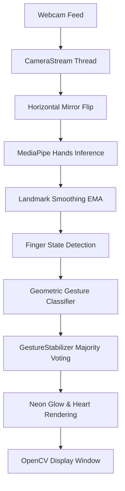

# Real-Time Hand Gesture Recognition


A lightweight, real-time computer vision system built with **Python**, **OpenCV**, and **MediaPipe** that detects 21 3D hand landmarks, tracks up to two hands simultaneously, and classifies hand gestures in real time using scale-invariant geometric analysis and vector projection.

---

## 📌 Project Overview

This project provides an interactive, low-latency vision pipeline for real-time hand gesture recognition through a standard consumer webcam. It blends geometric landmark analysis with computer vision rendering techniques, including neon glow skeletons, anti-aliased HUD metrics, temporal voting gesture stabilization, and experimental sequence detection.

---

## ✨ Key Features

- **Multi-Hand Tracking:** Tracks up to **2 hands** simultaneously in real time.
- **21 Landmark Detection:** Uses MediaPipe's hand tracking pipeline to compute 21 3D skeletal joints per hand.
- **Scale-Invariant Classification:** All landmark metrics are normalized by the anatomical palm size ($\|p_0 - p_9\|$), ensuring consistent gesture detection regardless of distance from the camera.
- **Threaded Frame Acquisition:** Camera reading runs on an independent background thread, preventing frame buffer lag and maximizing throughput.
- **Landmark Smoothing (EMA):** An Exponential Moving Average filter ($\alpha = 0.5$) blends sequential coordinate updates to eliminate landmark jitter.
- **Temporal Voting Stabilization:** A multi-frame majority voting filter (`GestureStabilizer`) eliminates single-frame misclassifications and prevents label flickering, with automatic history pruning when hands leave the frame.
- **Visual Feedback:** Custom dual-color neon skeleton rendering (Cyan for hand 1, Magenta for hand 2) with white joint nodes and high-visibility shadowed HUD text.
- **Live Finger Counter:** Displays the total count of extended fingers (0–10) across both visible hands.
- **Performance Monitor:** Built-in real-time FPS counter.

---

## ✋ Supported Gestures

| Gesture | Description | Visual Overlay |
|---|---|---|
| **Open Palm** | All five fingers fully extended | Gesture label + Finger count |
| **Fist** | All fingers folded into the palm | Gesture label (`Fist`) |
| **OK** | Thumb and index tips meet; middle, ring, pinky extended | Gesture label (`OK`) |
| **Pinch** | Thumb tip and index tip touch head-to-head; other fingers curled | Gesture label (`Pinch`) |
| **Finger Heart (🫰)** | Korean Finger Heart: thumb crossed over index finger DIP joint; remaining fingers curled | Gesture label + red heart symbol (**♥**) + floating mini-heart |
| **Peace** | Index and middle fingers extended in a V; others curled | Gesture label (`Peace`) |
| **Rock** | Index and pinky fingers extended; middle and ring curled | Gesture label (`Rock`) |
| **Pointing** | Index finger extended alone; other fingers curled | Gesture label (`Pointing`) |
| **Call Me** | Thumb and pinky extended; middle three fingers curled | Gesture label (`Call Me`) |
| **Thumbs Up** | Thumb extended vertically upward; other fingers curled | Gesture label (`Thumbs Up`) |
| **Thumbs Down** | Thumb extended vertically downward; other fingers curled | Gesture label (`Thumbs Down`) |

> [!NOTE]
> **Experimental "Signal for Help" Sequence:**
> The code includes a 2-step sequence detector for the domestic distress gesture (open palm with thumb tucked, followed by folding four fingers over the tucked thumb within 4 seconds). This is implemented strictly as an **educational computer vision proof-of-concept** and must **not** be relied upon as a life-safety or emergency detection system.

---

## 🛠️ Technologies Used

- **Language:** Python 3.11
- **Computer Vision:** OpenCV (`opencv-python 4.11.0`)
- **Machine Learning / Landmark Estimation:** Google MediaPipe (`mediapipe 0.10.14`)
- **Numerical Computing:** NumPy (`numpy 1.26.4`, strictly `< 2.0`)
- **Concurrency:** Python Standard Library (`threading`)

---

## 📁 Project Structure

```text
Computer-Vision-02/
│
├── .gitignore              # Git ignore rules for environments and temporary files
├── hand_gesture.py         # Main application source code
├── requirements.txt        # Pinned project dependencies
└── README.md               # Project documentation
```

---

## ⚙️ Installation & Setup (Windows)

### Prerequisites
- Windows 10 or 11 (64-bit)
- Python **3.11.x** installed (MediaPipe 0.10.14 requires Python 3.9–3.12; Python 3.11 is strongly recommended)
- A working internal or USB webcam

### 1. Clone the Repository
```powershell
git clone https://github.com/your-username/hand-gesture-recognition.git
cd hand-gesture-recognition
```

### 2. Create and Activate Virtual Environment
```powershell
# Create virtual environment using Python 3.11
py -3.11 -m venv .venv

# Activate the virtual environment in PowerShell
.\.venv\Scripts\Activate.ps1
```
*(If PowerShell restricts script execution, run `Set-ExecutionPolicy -ExecutionPolicy RemoteSigned -Scope CurrentUser` once).*

### 3. Upgrade Pip & Install Dependencies
```powershell
python -m pip install --upgrade pip
pip install -r requirements.txt
```

---

## 🚀 How to Run the Application

With your virtual environment activated:

```powershell
python hand_gesture.py
```
*(Or invoke directly using the virtual environment executable: `.\.venv\Scripts\python.exe hand_gesture.py`)*

### Controls
- **Hold Hand in View:** Display the webcam feed, glowing skeleton, HUD, and recognized gesture.
- **Exit Application:** Click the OpenCV window to focus it and press **`Q`** or **`q`**.

---

## 🔍 How the Application Works



1. **Threaded Capture (`CameraStream`):** Frames are acquired continuously in a daemon thread at $640 \times 480$ resolution to keep the main processing loop completely non-blocking.
2. **Mirroring & Colorspace:** The input frame is mirrored horizontally (`cv2.flip`) for natural interaction, then converted from BGR to RGB for MediaPipe.
3. **Landmark Inference:** MediaPipe processes the frame, extracting 21 $(x, y, z)$ landmarks per detected hand.
4. **EMA Smoothing (`Smoother`):** Raw coordinates are smoothed using an exponential moving average:
   $$\text{point}_{\text{smoothed}} = \alpha \cdot \text{point}_{\text{raw}} + (1 - \alpha) \cdot \text{point}_{\text{previous}}$$
5. **Finger State Evaluation (`finger_states`):** A finger is identified as extended ("up") when the distance from the wrist to the fingertip exceeds the distance from the wrist to its PIP joint by a margin ($> 1.1\times$).
6. **Vector Projection Classifier:**
   - **Finger Heart vs. Pinch:** Uses vector projection of the thumb tip ($p_4$) onto the index segment $[p_6, p_8]$. A standard Pinch meets at the tips ($t \approx 1.0$), whereas Finger Heart crosses the body of the index finger near the DIP joint ($t \in [0.25, 0.88]$) with the index tip extended past the thumb.
   - **All checks are scale-normalized** by dividing coordinates by palm size ($\|p_0 - p_9\|$), making detection robust to hand size and camera distance.
7. **Stabilization & Pruning (`GestureStabilizer`):** Maintains independent history buffers for each hand to suppress transient frame noise. When a hand leaves the camera frame, its state is pruned immediately.
8. **Neon Glow Rendering (`draw_neon`):** Thick colored lines are drawn onto a blank mask, blurred with a Gaussian kernel, and blended additively (`cv2.addWeighted`) onto the live video frame.

---

## 🔮 Future Improvements

- [ ] Support for dynamic / motion gestures (swipes, waving, circular motions).
- [ ] Landmark-based computer control (virtual mouse cursor, volume/brightness controls).
- [ ] Integration of a custom lightweight neural network / MLP for arbitrary gesture vocabulary expansion.
- [ ] Web-based interface using Streamlit or WebRTC.

---

## 👤 Author

- **Author:** Suhani Shinde
- **Repository:** [https://github.com/your-username/hand-gesture-recognition](https://github.com/your-username/hand-gesture-recognition)

---

## 📄 License

This project is open-source and available under the [MIT License](LICENSE).

